<!-- Generated by scripts/build.py — edit profile.json, not this file. -->

<p align="center">
<picture><source media="(prefers-color-scheme: dark)" srcset="assets/cards/dark/hero.svg"><source media="(prefers-color-scheme: light)" srcset="assets/cards/light/hero.svg">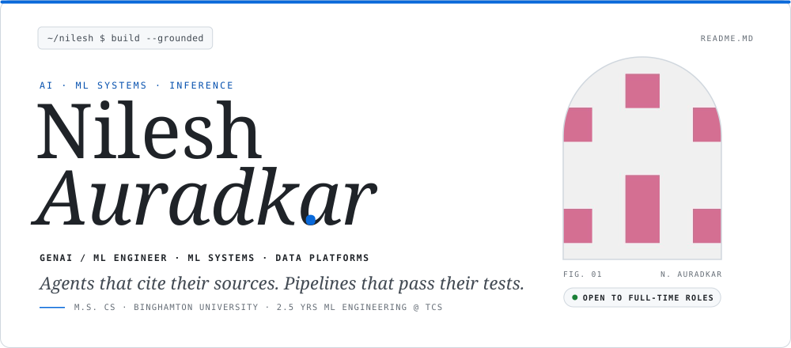</picture>
</p>

<p align="center">
<a href="https://github.com/nilesh-auradkar05"><picture><source media="(prefers-color-scheme: dark)" srcset="assets/cards/dark/pill-github.svg"><source media="(prefers-color-scheme: light)" srcset="assets/cards/light/pill-github.svg"></picture></a>
</p>

<p align="center">
<picture><source media="(prefers-color-scheme: dark)" srcset="assets/cards/dark/about.svg"><source media="(prefers-color-scheme: light)" srcset="assets/cards/light/about.svg">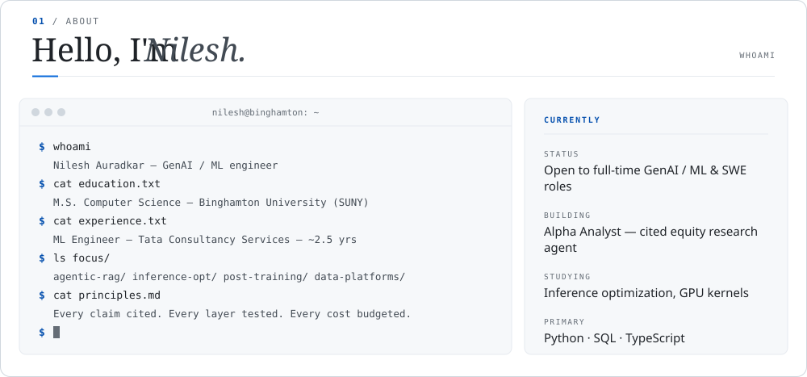</picture>
</p>

<p align="center">
<picture><source media="(prefers-color-scheme: dark)" srcset="assets/cards/dark/record.svg"><source media="(prefers-color-scheme: light)" srcset="assets/cards/light/record.svg">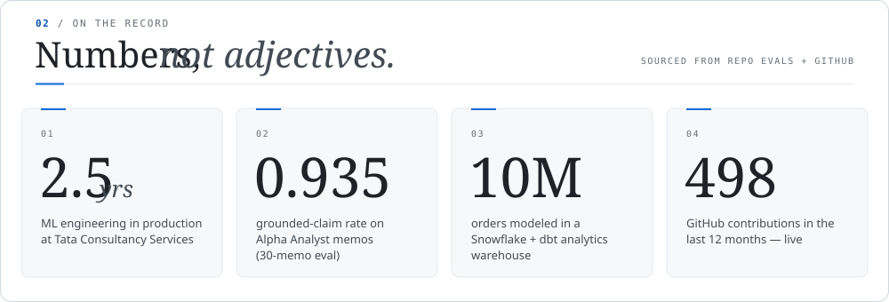</picture>
</p>

<p align="center">
<picture><source media="(prefers-color-scheme: dark)" srcset="assets/cards/dark/h-papers.svg"><source media="(prefers-color-scheme: light)" srcset="assets/cards/light/h-papers.svg">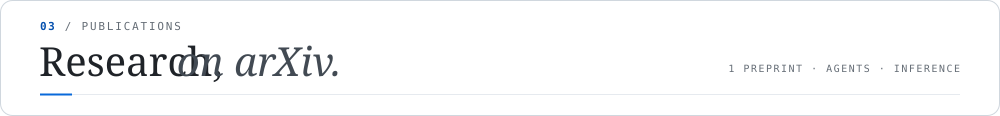</picture>
</p>

<p align="center">
<a href="https://arxiv.org/abs/2610.07311"><picture><source media="(prefers-color-scheme: dark)" srcset="assets/cards/dark/paper-2610-07311.svg"><source media="(prefers-color-scheme: light)" srcset="assets/cards/light/paper-2610-07311.svg"></picture></a>
</p>

<details>
<summary><b>Cite</b> (BibTeX)</summary>

```bibtex
@misc{tang2026overreliance,
  title         = {Understanding and Mitigating Inference-Time Overreliance Using Agentic Memory},
  author        = {Tang, Luoxi and Meng, Yuqiao and Auradkar, Nilesh and Ye, Muchao and Zhang, Dazheng and Xi, Zhaohan},
  year          = {2026},
  eprint        = {2610.07311},
  archivePrefix = {arXiv},
  primaryClass  = {cs.AI},
  url           = {https://arxiv.org/abs/2610.07311}
}
```

</details>

<p align="center">
<picture><source media="(prefers-color-scheme: dark)" srcset="assets/cards/dark/h-work.svg"><source media="(prefers-color-scheme: light)" srcset="assets/cards/light/h-work.svg">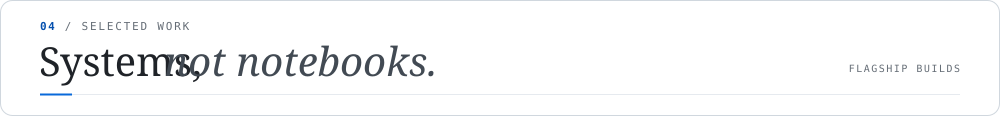</picture>
</p>

<p align="center">
<a href="https://github.com/nilesh-auradkar05/Financial-Analyst-Agent"><picture><source media="(prefers-color-scheme: dark)" srcset="assets/cards/dark/project-alpha-analyst.svg"><source media="(prefers-color-scheme: light)" srcset="assets/cards/light/project-alpha-analyst.svg">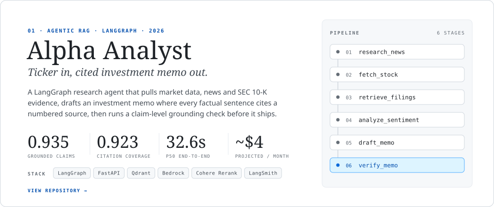</picture></a>
</p>

<p align="center">
<a href="https://github.com/nilesh-auradkar05/Food-Delivery-Intelligence-Platform-End-to-End-Data-Engineering-AI-Analytics"><picture><source media="(prefers-color-scheme: dark)" srcset="assets/cards/dark/project-food-delivery.svg"><source media="(prefers-color-scheme: light)" srcset="assets/cards/light/project-food-delivery.svg">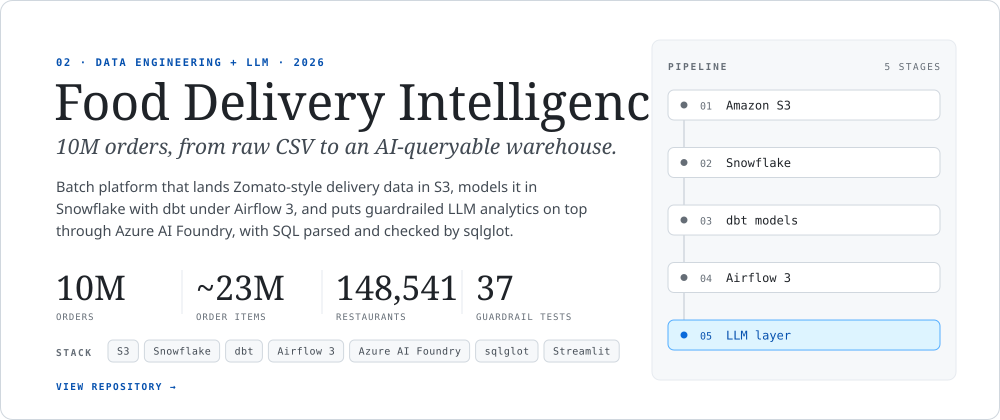</picture></a>
</p>

<p align="center">
<a href="https://github.com/nilesh-auradkar05/Walmart-DE"><picture><source media="(prefers-color-scheme: dark)" srcset="assets/cards/dark/project-retail-cdc.svg"><source media="(prefers-color-scheme: light)" srcset="assets/cards/light/project-retail-cdc.svg">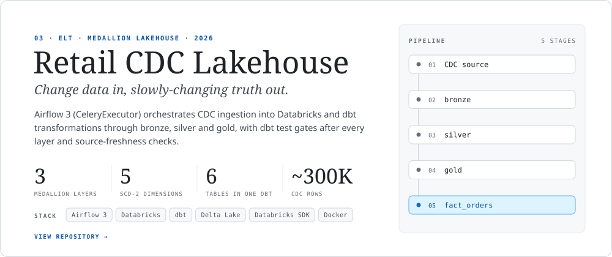</picture></a>
</p>

<p align="center">
<picture><source media="(prefers-color-scheme: dark)" srcset="assets/cards/dark/h-bench.svg"><source media="(prefers-color-scheme: light)" srcset="assets/cards/light/h-bench.svg"></picture>
</p>

<p align="center">
<a href="https://github.com/nilesh-auradkar05/RLHF-Playground"><picture><source media="(prefers-color-scheme: dark)" srcset="assets/cards/dark/bench-01.svg"><source media="(prefers-color-scheme: light)" srcset="assets/cards/light/bench-01.svg">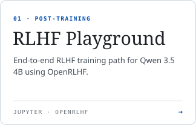</picture></a><a href="https://github.com/nilesh-auradkar05/InferenceForge"><picture><source media="(prefers-color-scheme: dark)" srcset="assets/cards/dark/bench-02.svg"><source media="(prefers-color-scheme: light)" srcset="assets/cards/light/bench-02.svg">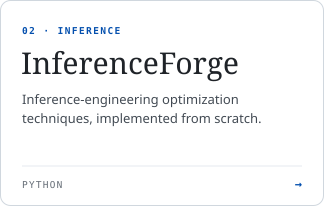</picture></a><a href="https://github.com/nilesh-auradkar05/DeepSeekV3_replica"><picture><source media="(prefers-color-scheme: dark)" srcset="assets/cards/dark/bench-03.svg"><source media="(prefers-color-scheme: light)" srcset="assets/cards/light/bench-03.svg">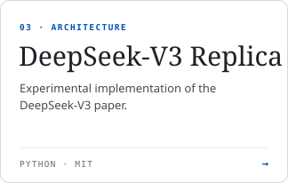</picture></a>
</p>

<p align="center">
<a href="https://github.com/nilesh-auradkar05/VLM-Playground"><picture><source media="(prefers-color-scheme: dark)" srcset="assets/cards/dark/bench-04.svg"><source media="(prefers-color-scheme: light)" srcset="assets/cards/light/bench-04.svg">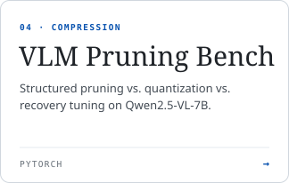</picture></a><a href="https://github.com/nilesh-auradkar05/DrGRPO-Reinforced-Instruction-Fine-Tuning"><picture><source media="(prefers-color-scheme: dark)" srcset="assets/cards/dark/bench-05.svg"><source media="(prefers-color-scheme: light)" srcset="assets/cards/light/bench-05.svg">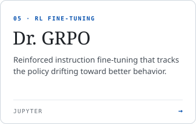</picture></a><a href="https://github.com/nilesh-auradkar05/CopilotX-MCP-Enabled-Agentic-RAG-Copilot"><picture><source media="(prefers-color-scheme: dark)" srcset="assets/cards/dark/bench-06.svg"><source media="(prefers-color-scheme: light)" srcset="assets/cards/light/bench-06.svg">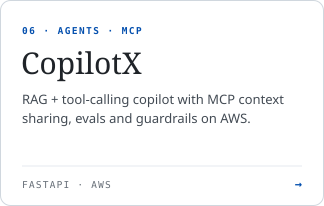</picture></a>
</p>

<p align="center">
<picture><source media="(prefers-color-scheme: dark)" srcset="assets/cards/dark/toolkit.svg"><source media="(prefers-color-scheme: light)" srcset="assets/cards/light/toolkit.svg">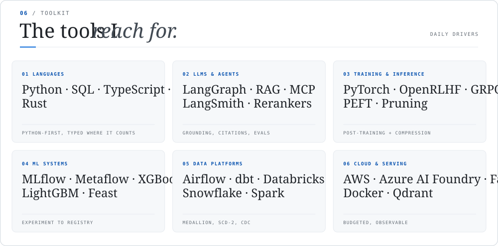</picture>
</p>

<p align="center">
<picture><source media="(prefers-color-scheme: dark)" srcset="assets/cards/dark/heatmap.svg"><source media="(prefers-color-scheme: light)" srcset="assets/cards/light/heatmap.svg">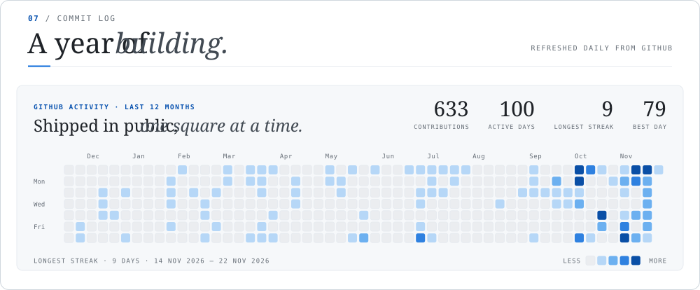</picture>
</p>

<p align="center">
<picture><source media="(prefers-color-scheme: dark)" srcset="assets/cards/dark/h-wip.svg"><source media="(prefers-color-scheme: light)" srcset="assets/cards/light/h-wip.svg">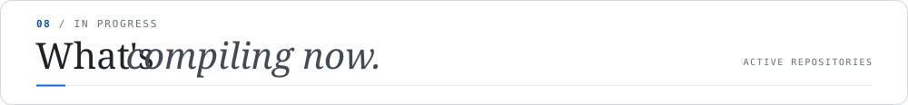</picture>
</p>

<p align="center">
<a href="https://github.com/nilesh-auradkar05/Causal-Dynamic-Pricing-Inside-Airbnb-Revenue-Optimization"><picture><source media="(prefers-color-scheme: dark)" srcset="assets/cards/dark/wip-01.svg"><source media="(prefers-color-scheme: light)" srcset="assets/cards/light/wip-01.svg"></picture></a>
</p>

<p align="center">
<a href="https://github.com/nilesh-auradkar05/Bluesky-RealTime-Content-Recommendation"><picture><source media="(prefers-color-scheme: dark)" srcset="assets/cards/dark/wip-02.svg"><source media="(prefers-color-scheme: light)" srcset="assets/cards/light/wip-02.svg"></picture></a>
</p>

<p align="center">
<a href="https://github.com/nilesh-auradkar05/Real-Time-Banking-Transaction-Lakehouse-and-Financial-Reconciliation-Platform"><picture><source media="(prefers-color-scheme: dark)" srcset="assets/cards/dark/wip-03.svg"><source media="(prefers-color-scheme: light)" srcset="assets/cards/light/wip-03.svg"></picture></a>
</p>

<p align="center">
<a href="https://github.com/nilesh-auradkar05/PulsePress"><picture><source media="(prefers-color-scheme: dark)" srcset="assets/cards/dark/wip-04.svg"><source media="(prefers-color-scheme: light)" srcset="assets/cards/light/wip-04.svg"></picture></a>
</p>

<p align="center">
<picture><source media="(prefers-color-scheme: dark)" srcset="assets/cards/dark/connect.svg"><source media="(prefers-color-scheme: light)" srcset="assets/cards/light/connect.svg">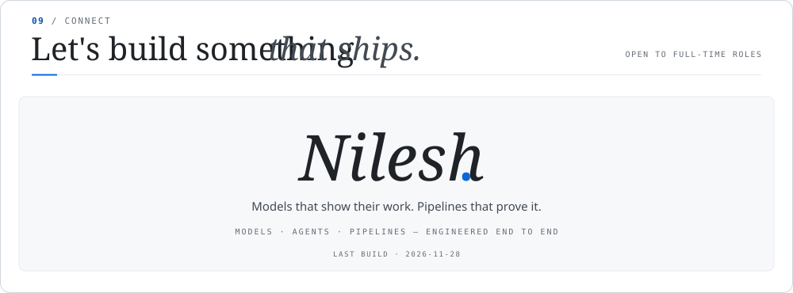</picture>
</p>

<p align="center">
<a href="https://github.com/nilesh-auradkar05"><picture><source media="(prefers-color-scheme: dark)" srcset="assets/cards/dark/pill-github.svg"><source media="(prefers-color-scheme: light)" srcset="assets/cards/light/pill-github.svg"></picture></a>
</p>
