<!-- Generated by scripts/build.py — edit profile.json, not this file. -->

<p align="center">
</p>

<p align="center">
<a href="https://github.com/nilesh-auradkar05"></a>
</p>

<p align="center">
</p>

<p align="center">
</p>

<p align="center">

</p>

<p align="center">
<a href="https://arxiv.org/abs/2610.07311"></a>
</p>

<details>
<summary><b>Cite</b> (BibTeX)</summary>

```bibtex
@misc{tang2026overreliance,
  title         = {Understanding and Mitigating Inference-Time Overreliance Using Agentic Memory},
  author        = {Tang, Luoxi and Meng, Yuqiao and Auradkar, Nilesh and Ye, Muchao and Zhang, Dazheng and Xi, Zhaohan},
  year          = {2026},
  eprint        = {2610.07311},
  archivePrefix = {arXiv},
  primaryClass  = {cs.AI},
  url           = {https://arxiv.org/abs/2610.07311}
}
```

</details>

<p align="center">

</p>

<p align="center">
<a href="https://github.com/nilesh-auradkar05/Financial-Analyst-Agent"></a>
</p>

<p align="center">
<a href="https://github.com/nilesh-auradkar05/Food-Delivery-Intelligence-Platform-End-to-End-Data-Engineering-AI-Analytics"></a>
</p>

<p align="center">
<a href="https://github.com/nilesh-auradkar05/Walmart-DE"></a>
</p>

<p align="center">

</p>

<p align="center">
<a href="https://github.com/nilesh-auradkar05/RLHF-Playground"></a><a href="https://github.com/nilesh-auradkar05/InferenceForge"></a><a href="https://github.com/nilesh-auradkar05/DeepSeekV3_replica"></a>
</p>

<p align="center">
<a href="https://github.com/nilesh-auradkar05/VLM-Playground"></a><a href="https://github.com/nilesh-auradkar05/DrGRPO-Reinforced-Instruction-Fine-Tuning"></a><a href="https://github.com/nilesh-auradkar05/CopilotX-MCP-Enabled-Agentic-RAG-Copilot"></a>
</p>

<p align="center">
</p>

<p align="center">
</p>

<p align="center">

</p>

<p align="center">
<a href="https://github.com/nilesh-auradkar05/Causal-Dynamic-Pricing-Inside-Airbnb-Revenue-Optimization"></a>
</p>

<p align="center">
<a href="https://github.com/nilesh-auradkar05/Bluesky-RealTime-Content-Recommendation"></a>
</p>

<p align="center">
<a href="https://github.com/nilesh-auradkar05/Real-Time-Banking-Transaction-Lakehouse-and-Financial-Reconciliation-Platform"></a>
</p>

<p align="center">
<a href="https://github.com/nilesh-auradkar05/PulsePress"></a>
</p>

<p align="center">
</p>

<p align="center">
<a href="https://github.com/nilesh-auradkar05"></a>
</p>
